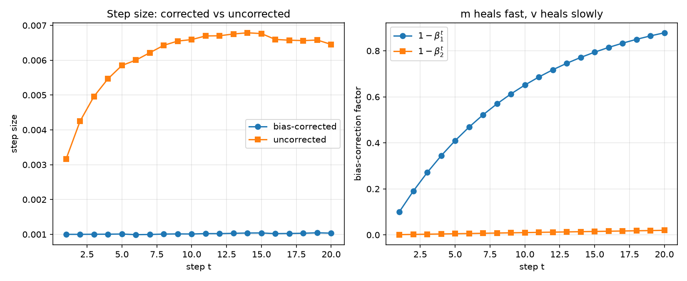
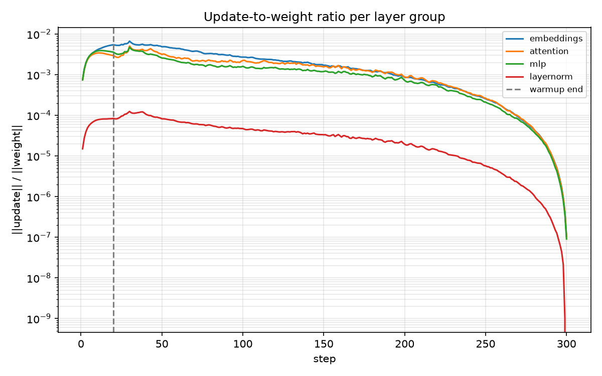
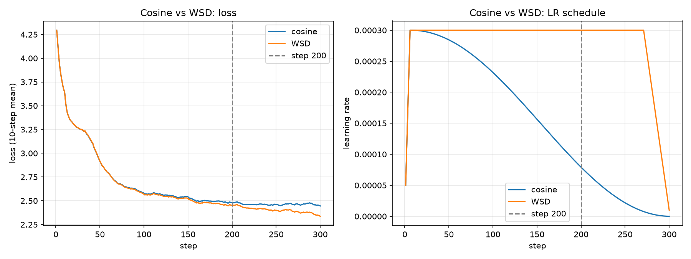
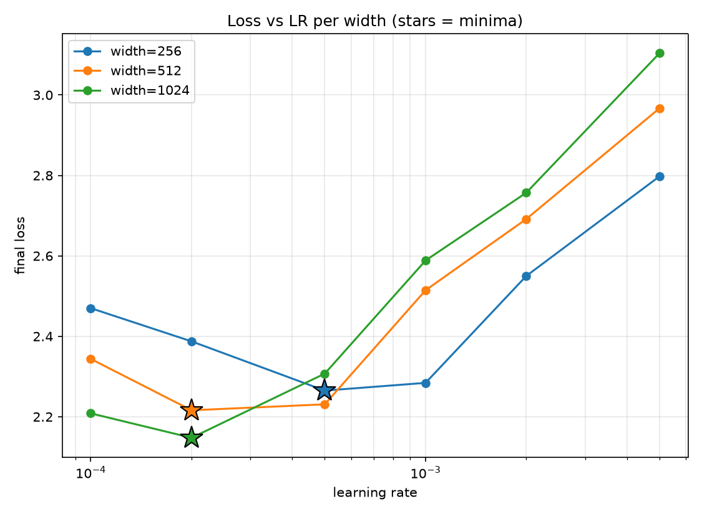

# Optimizers & Learning-Rate Schedules

## Reproduce Adam by hand

One weight (`w=0`), gradients `[0.50, 0.40, 0.60, 0.45, 0.55]`, `lr=1e-3`, `β=(0.9, 0.999)`.

| t | g | m | v | m̂ | v̂ | step | hand `w` | PyTorch `w` | abs diff |
|---|---|---|---|---|---|---|---|---|---|
| 1 | 0.50 | 0.050000 | 0.000250 | 0.5000 | 0.250000 | 0.001000 | -0.001000 | -0.001000 | 4.89e-11 |
| 2 | 0.40 | 0.085000 | 0.000410 | 0.4474 | 0.204977 | 0.000988 | -0.001988 | -0.001988 | 3.01e-11 |
| 3 | 0.60 | 0.136500 | 0.000769 | 0.5037 | 0.256703 | 0.000994 | -0.002982 | -0.002982 | 2.74e-11 |
| 4 | 0.45 | 0.167850 | 0.000971 | 0.4881 | 0.243132 | 0.000990 | -0.003972 | -0.003972 | 1.65e-10 |
| 5 | 0.55 | 0.206065 | 0.001273 | 0.5032 | 0.255030 | 0.000996 | -0.004969 | -0.004969 | 2.71e-10 |

**Max difference: 2.71e-10. Match.**

## Disable bias correction, plot 20 steps

| | value |
|---|---|
| `1-β1^t` at t=20 | 0.878 |
| `1-β2^t` at t=20 | 0.0198 |
| uncorrected / corrected step at t=20 | 6.24x |
| within 5% by step 20? | No |
| step where they come within 5% | **2,375** |

`m` heals in ~10 steps, `v` needs ~1000. Without correction `v` stays too small, so the step is ~6x too large for the whole 20-step window. The difference stops mattering only after ~2,400 steps.

## Update-to-weight ratio, and when warmup stops mattering

300 steps, 20-step warmup + cosine, peak LR 3e-4.

| group | step 1 | step 20 (warmup end) | step 40 | step 300 |
|---|---|---|---|---|
| embeddings | 7.46e-04 | 5.46e-03 | 5.36e-03 | 1.07e-07 |
| attention | 7.50e-04 | 2.97e-03 | 3.91e-03 | 1.03e-07 |
| mlp | 7.49e-04 | 3.60e-03 | 3.31e-03 | 9.04e-08 |
| layernorm | 1.50e-05 | 8.39e-05 | 1.07e-04 | 0 |

All groups peak at **step 30**, so warmup stops changing the ratio about 10 steps after it ends; cosine decay takes over after that. Embeddings get the largest relative updates; layernorm is ~2 orders of magnitude lower.

## Cosine vs WSD, both stopped at step 200 of a 300-step plan

| step | cosine | WSD |
|---|---|---|
| **200** | 2.4831 | **2.4543** |
| 300 | 2.4458 | **2.3367** |

**I would keep WSD.** It has lower loss at 200, and it is still at 100% peak LR (cosine is at 26%), so it can be annealed from there. Cosine at 200 is stuck halfway through a decay planned for 300.

## LR sweep at widths 256/512/1024, extrapolated to 4096

3 layers, `head_dim=64`, 6 LRs per width, 300 steps each.

| width | params | best LR | loss |
|---|---|---|---|
| 256 | 2,394,112 | 5e-4 | 2.2650 |
| 512 | 9,506,816 | 2e-4 | 2.2160 |
| 1024 | 37,888,000 | 2e-4 | 2.1476 |

Fit: `log(lr) = -0.661·log(width) - 4.088` (R² = 0.75).

**At width 4096 I would use ~7e-5.** My confidence is low to moderate: the fit has only 3 points on a coarse LR grid, 1 seed, and is extrapolated 4x past the largest width I measured. I would confirm it with a short sweep around 5e-5 to 2e-4 before committing.
